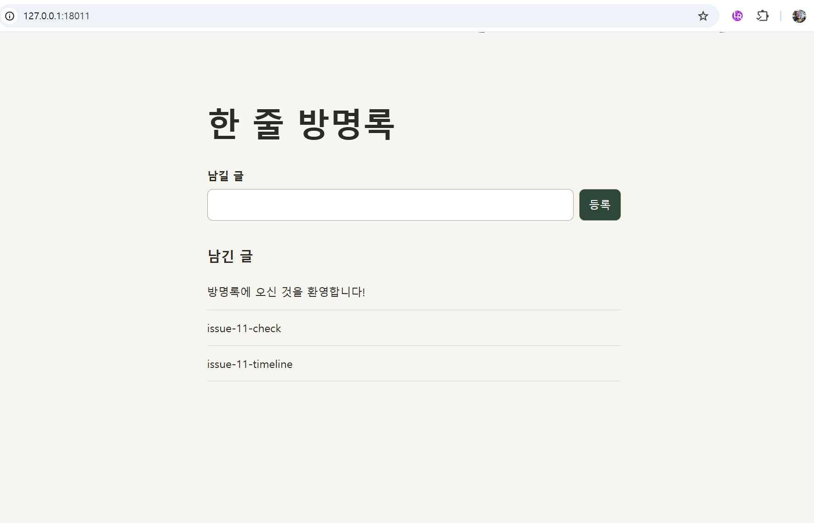
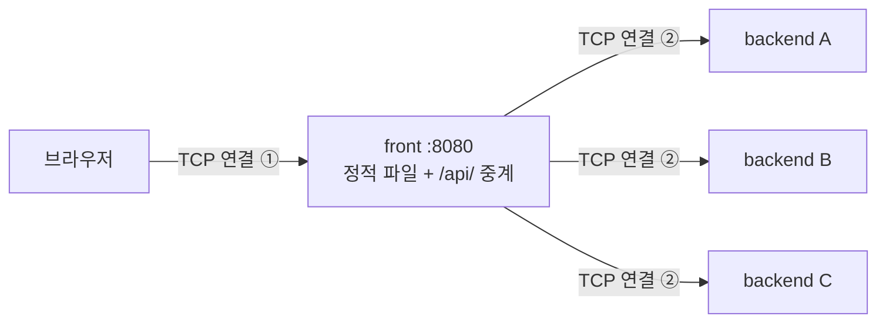
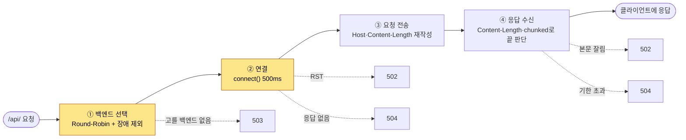
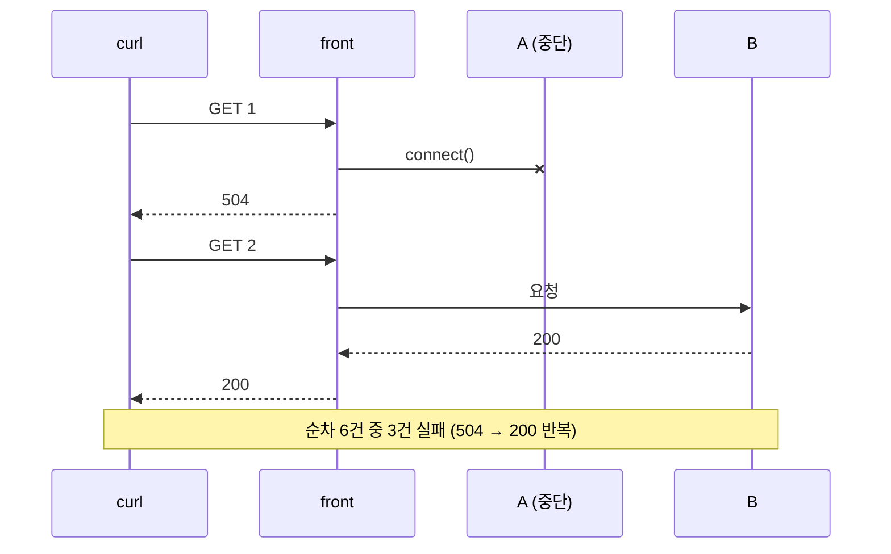
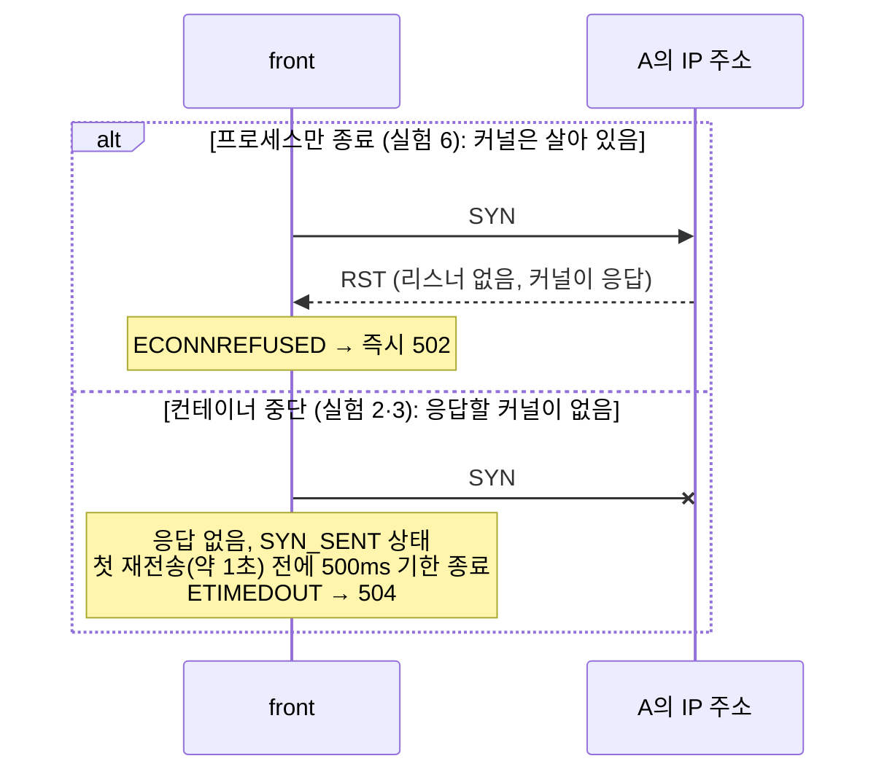
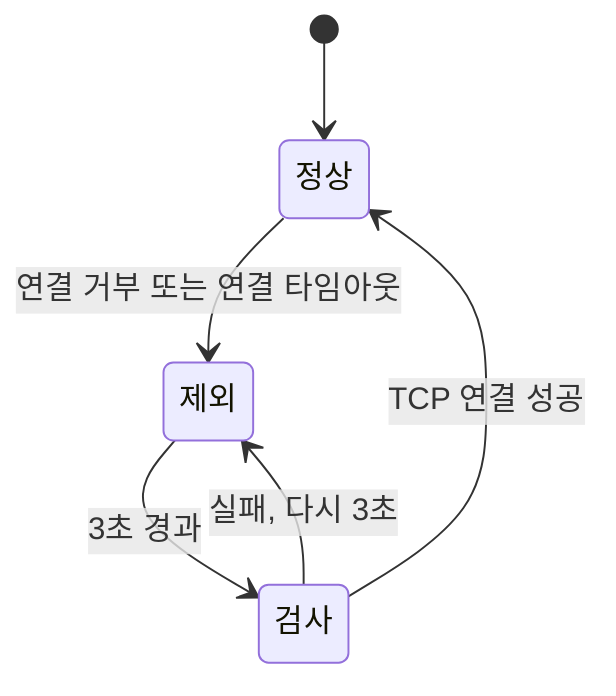
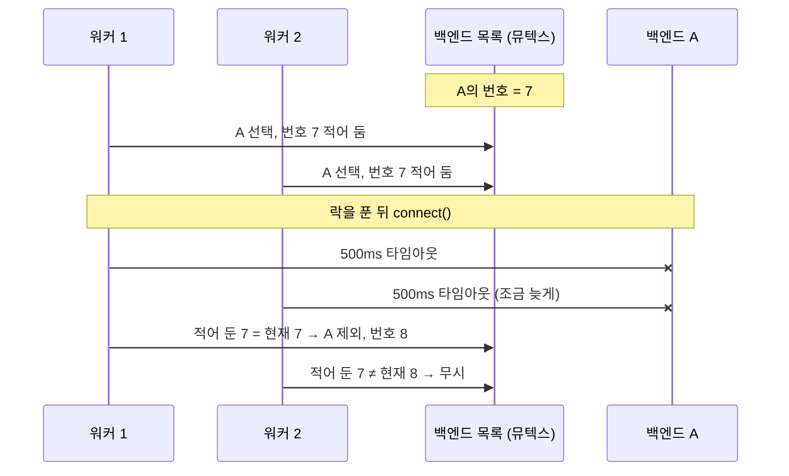
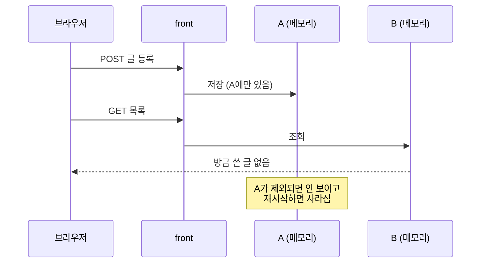

# 한 줄 방명록의 리버스 프록시 장애 우회

## 1. 구조

C로 만든 HTTP/1.1 서버다. 앞단은 정적 파일을 제공하고 `/api/`를 백엔드에 중계한다.

프록시가 백엔드에 요청을 보내는 단계와 실패 응답이다. 이번 발표는 강조한 ①·② 단계를 다룬다.

## 2. 기존 Round-Robin의 문제

기존 A·B 구성은 A 연결이 실패한 뒤에도 등록 순서대로 배정했다.

## 3. 502 대신 504가 나온 이유

닫힌 포트의 `502`를 예상했다. 컨테이너를 중단하자 `/proc/net/tcp`에서 `SYN_SENT`을 관찰했고, `504`는 527ms와 502ms에 돌아왔다.
RST는 백엔드 프로세스가 아니라 상대 호스트의 커널이 보낸다.

## 4. 장애 백엔드 제외와 복구 확인

첫 장애 요청은 `502` 또는 `504`로 끝난다. 이후 연결 확인은 백그라운드 스레드가 맡고, 배정 가능한 백엔드가 없으면 `503`을 반환한다.
1초 제외는 3초보다 복귀가 빠른 대신 장애 중 실패가 잦았다. 별도 확인에는 스레드와 연결 시도 비용이 든다.

| 바꾼 것 | 측정 | 바꾸기 전 | 바꾼 뒤 |
|---|---|---|---|
| 장애 백엔드 3초 제외 | 순차 GET 6건 (A·B 두 대) | 실패 3건 | 실패 1건 |
| 복구 확인을 백그라운드로 | 실제 재시작 중 GET 70건 (A·B·C 세 대) | `504` 2건 (사용자 요청이 확인) | 최초 연결 오류 1건 (2회 실행 모두) |

## 5. 백엔드 선택의 동기화

`src/proxy.c`의 `next_backend()`는 커서와 제외 상태를 함께 봐야 하므로 커서의 atomic 갱신만으로는 부족하다. 뮤텍스로 선택을 보호하고 연결은 락 밖에서 시도해 다른 요청이 최대 500ms의 연결 대기를 공유하지 않게 한다.
`record_backend_connection()`은 `generation`으로 이전 배정의 늦은 결과를 걸러낸다. 도식의 세대 번호는 이 동작을 보여주는 예시다.

## 6. 한계

글은 백엔드별 메모리에 남으므로 장애 실험은 GET으로 진행했다. 첫 장애 요청은 오류로 끝나며, 이미 처리됐을 수 있는 요청은 재전송하지 않는다.
TCP 검사는 연결만 확인하므로 API의 정상 응답까지 보장하지 않는다(실험 9).

HTTP 검사도 실험했지만 적용하지 않았다(실험 9). 실제 재시작에서는 TCP 연결 뒤 API가 준비되지 않은 구간이 관찰되지 않았고(실험 10), HTTP 검사는 응답까지 읽어야 해 비용이 더 든다.

## 7. 참고 문서

[실행 및 현재 정책](../README.md) · [실험 1~10의 방법과 결과](round-robin-failover.md)
